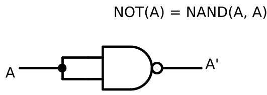
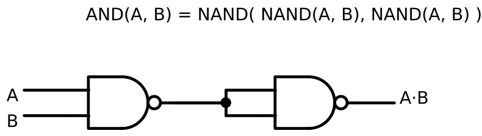
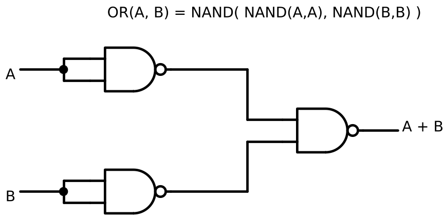
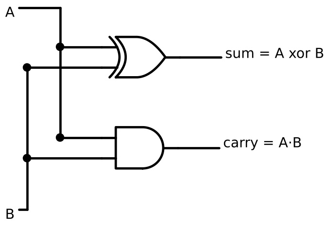
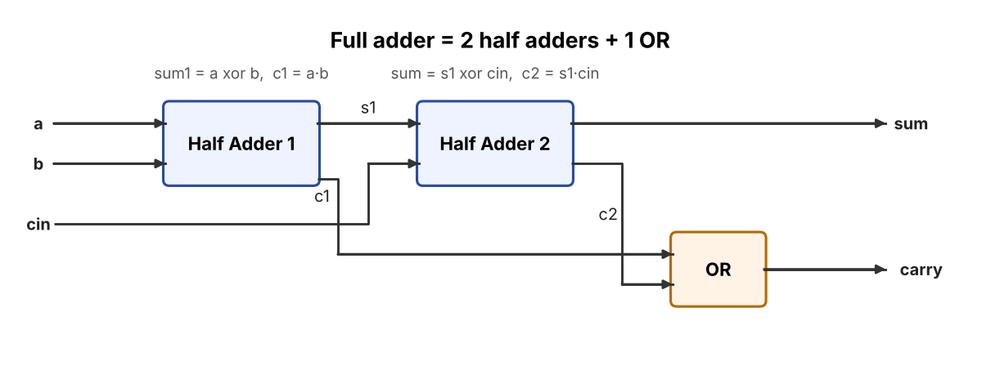
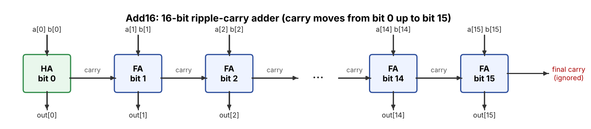
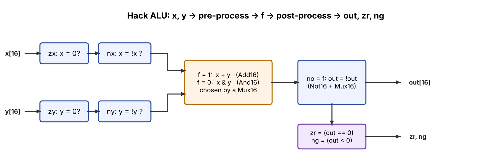

# Lab 1 – Digital Logic and ALU Design

**Course:** Nand to Tetris – I (ETCCNT301), K.R. Mangalam University  
**Name:** Harsh Dabas | **Roll no:** 2501730061  
**Tools:** Nand2Tetris Hardware Simulator (Projects 1 and 2)

All chips in this folder were simulated with the Nand2Tetris simulator and the official test scripts (`.tst` / `.cmp`).
The text output of every run is saved in [`output/`](output/) and the logic diagrams are in [`diagrams/`](diagrams/).

## Test results

| Test script | Chip | Result |
|---|---|---|
| Not.tst | Not | ✅ PASS |
| And.tst | And | ✅ PASS |
| Or.tst | Or | ✅ PASS |
| Xor.tst | Xor | ✅ PASS |
| Mux.tst | Mux | ✅ PASS |
| DMux.tst | DMux | ✅ PASS |
| Mux4Way16.tst | Mux4Way16 | ✅ PASS |
| HalfAdder.tst | HalfAdder | ✅ PASS |
| FullAdder.tst | FullAdder | ✅ PASS |
| Add16.tst | Add16 | ✅ PASS |
| Add16-samples.tst (mine) | Add16 | ✅ PASS |
| ALU.tst | ALU | ✅ PASS |
| ALU-basic.tst | ALU | ✅ PASS |
| ALU-18.tst (mine) | ALU | ✅ PASS |

Note: when a chip uses another chip (for example `Xor` uses `Not`, `And`, `Or`), the simulator picks its own built-in version of that part. So each file is checked for correct wiring on top of the built-in parts, and the NAND-only chips `Not`, `And` and `Or` are each tested on their own with the official scripts.

`Add16-samples.tst` (Question 4) and `ALU-18.tst` (Question 5) are my own test scripts. Their expected `.cmp` files were produced by a separate Python model, and the HDL had to match them.

## Folder layout

| File / folder | What it is |
|---|---|
| `Not.hdl`, `And.hdl`, `Or.hdl` | Question 1: built from `Nand` only |
| `Xor.hdl`, `Mux.hdl`, `DMux.hdl`, `Mux4Way16.hdl` (+ `Mux16.hdl`) | Question 2 |
| `HalfAdder.hdl`, `FullAdder.hdl` | Question 3 |
| `Add16.hdl` | Question 4 |
| `ALU.hdl` (+ `Not16.hdl`, `And16.hdl`, `Or8Way.hdl`) | Question 5 |
| `*.tst`, `*.cmp` | test scripts and expected output |
| `output/` | simulator output for every run |
| `diagrams/` | logic and block diagrams |

---

## Question 1 – NOT, AND, OR using only NAND gates

**Why NAND is universal:** NAND alone can build NOT, AND and OR, and every Boolean function can be written with those three. So any circuit can be built from NAND gates only.

### NOT = 1 NAND (both inputs tied together)
Boolean expression: `Y = (A·A)' = A'`



```hdl
// Not gate built from ONE Nand gate.
// Tie both inputs together: Nand(a, a) = not(a and a) = not a
CHIP Not {
    IN in;
    OUT out;

    PARTS:
    Nand(a=in, b=in, out=out);
}
```

| A | NAND(A,A) = A' |
|---|---|
| 0 | 1 |
| 1 | 0 |

### AND = 2 NAND
Boolean expression: `Y = ((A·B)')' = A·B`. The second NAND acts as a NOT on the first one.



```hdl
// And gate built from TWO Nand gates.
// And(a, b) = Not(Nand(a, b)), and Not is a Nand with both inputs tied.
CHIP And {
    IN a, b;
    OUT out;

    PARTS:
    Nand(a=a, b=b, out=nandab);
    Nand(a=nandab, b=nandab, out=out);
}
```

| A | B | NAND(A,B) | AND = NAND(NAND(A,B), NAND(A,B)) |
|---|---|---|---|
| 0 | 0 | 1 | 0 |
| 0 | 1 | 1 | 0 |
| 1 | 0 | 1 | 0 |
| 1 | 1 | 0 | 1 |

### OR = 3 NAND
Boolean expression (De Morgan): `Y = (A'·B')' = A + B`



```hdl
// Or gate built from THREE Nand gates (De Morgan).
// a or b = not(not a and not b) = Nand(Not a, Not b)
CHIP Or {
    IN a, b;
    OUT out;

    PARTS:
    Nand(a=a, b=a, out=nota);
    Nand(a=b, b=b, out=notb);
    Nand(a=nota, b=notb, out=out);
}
```

| A | B | A' = NAND(A,A) | B' = NAND(B,B) | OR = NAND(A', B') |
|---|---|---|---|---|
| 0 | 0 | 1 | 1 | 0 |
| 0 | 1 | 1 | 0 | 1 |
| 1 | 0 | 0 | 1 | 1 |
| 1 | 1 | 0 | 0 | 1 |

### Simulation output (official `Not.tst`, `And.tst`, `Or.tst`)
`Not`:
```text
|in |out|
| 0 | 1 |
| 1 | 0 |
```
`And`:
```text
| a | b |out|
| 0 | 0 | 0 |
| 0 | 1 | 0 |
| 1 | 0 | 0 |
| 1 | 1 | 1 |
```
`Or`:
```text
| a | b |out|
| 0 | 0 | 0 |
| 0 | 1 | 1 |
| 1 | 0 | 1 |
| 1 | 1 | 1 |
```

---

## Question 2 – XOR, Mux (2-way, 4-way) and DMux

### XOR
`A xor B = A·B' + A'·B`

```hdl
// Xor gate: out = (a and not b) or (not a and b)
CHIP Xor {
    IN a, b;
    OUT out;

    PARTS:
    Not(in=a, out=nota);
    Not(in=b, out=notb);
    And(a=a, b=notb, out=w1);
    And(a=nota, b=b, out=w2);
    Or(a=w1, b=w2, out=out);
}
```

| A | B | A·B' | A'·B | XOR = A·B' + A'·B |
|---|---|---|---|---|
| 0 | 0 | 0 | 0 | 0 |
| 0 | 1 | 0 | 1 | 1 |
| 1 | 0 | 1 | 0 | 1 |
| 1 | 1 | 0 | 0 | 0 |

### Mux (2-way)
`out = a·sel' + b·sel`, so `sel = 0` selects `a` and `sel = 1` selects `b`.

```hdl
// 2-way multiplexer: out = a if sel = 0, out = b if sel = 1
// out = (a and not sel) or (b and sel)
CHIP Mux {
    IN a, b, sel;
    OUT out;

    PARTS:
    Not(in=sel, out=notsel);
    And(a=a, b=notsel, out=w1);
    And(a=b, b=sel, out=w2);
    Or(a=w1, b=w2, out=out);
}
```

| a | b | sel | out |
|---|---|---|---|
| 0 | 0 | 0 | 0 |
| 0 | 0 | 1 | 0 |
| 0 | 1 | 0 | 0 |
| 0 | 1 | 1 | 1 |
| 1 | 0 | 0 | 1 |
| 1 | 0 | 1 | 0 |
| 1 | 1 | 0 | 1 |
| 1 | 1 | 1 | 1 |

### Mux4Way16 (4-way, 16-bit)
A 4-way mux is three 2-way muxes: `sel[0]` chooses inside each pair, then `sel[1]` chooses between the pairs. (The 1-bit 4-way mux is the same circuit with a bus width of 1.)

```hdl
// 4-way 16-bit multiplexor: sel 00=a, 01=b, 10=c, 11=d
CHIP Mux4Way16 {
    IN a[16], b[16], c[16], d[16], sel[2];
    OUT out[16];
    PARTS:
    Mux16(a=a, b=b, sel=sel[0], out=ab);
    Mux16(a=c, b=d, sel=sel[0], out=cd);
    Mux16(a=ab, b=cd, sel=sel[1], out=out);
}
```

| sel[1] | sel[0] | out | Stage 1 (Mux16 on sel[0]) | Stage 2 (Mux16 on sel[1]) |
|---|---|---|---|---|
| 0 | 0 | a | ab: a, cd: c | picks ab |
| 0 | 1 | b | ab: b, cd: d | picks ab |
| 1 | 0 | c | ab: a, cd: c | picks cd |
| 1 | 1 | d | ab: b, cd: d | picks cd |

### DMux
`a = in·sel'`, `b = in·sel`

```hdl
// Demultiplexor: {a, b} = {in, 0} if sel = 0, {0, in} if sel = 1
CHIP DMux {
    IN in, sel;
    OUT a, b;

    PARTS:
    Not(in=sel, out=notsel);
    And(a=in, b=notsel, out=a);
    And(a=in, b=sel, out=b);
}
```

| in | sel | a | b |
|---|---|---|---|
| 0 | 0 | 0 | 0 |
| 0 | 1 | 0 | 0 |
| 1 | 0 | 1 | 0 |
| 1 | 1 | 0 | 1 |

### Simulation output
`Xor`:
```text
| a | b |out|
| 0 | 0 | 0 |
| 0 | 1 | 1 |
| 1 | 0 | 1 |
| 1 | 1 | 0 |
```
`Mux`:
```text
| a | b |sel|out|
| 0 | 0 | 0 | 0 |
| 0 | 0 | 1 | 0 |
| 0 | 1 | 0 | 0 |
| 0 | 1 | 1 | 1 |
| 1 | 0 | 0 | 1 |
| 1 | 0 | 1 | 0 |
| 1 | 1 | 0 | 1 |
| 1 | 1 | 1 | 1 |
```
`DMux`:
```text
|in |sel| a | b |
| 0 | 0 | 0 | 0 |
| 0 | 1 | 0 | 0 |
| 1 | 0 | 1 | 0 |
| 1 | 1 | 0 | 1 |
```

All of `Xor`, `Mux`, `DMux` and `Mux4Way16` end with a match against the official `.cmp` files (see the table at the top; the `Mux4Way16` output is in `output/Mux4Way16.out`).

---

## Question 3 – Half Adder and Full Adder

### Half Adder
`sum = A xor B`, `carry = A·B`



```hdl
// Adds two bits: sum = a xor b, carry = a and b
CHIP HalfAdder {
    IN a, b;
    OUT sum, carry;
    PARTS:
    Xor(a=a, b=b, out=sum);
    And(a=a, b=b, out=carry);
}
```

| A | B | sum = A⊕B | carry = A·B |
|---|---|---|---|
| 0 | 0 | 0 | 0 |
| 0 | 1 | 1 | 0 |
| 1 | 0 | 1 | 0 |
| 1 | 1 | 0 | 1 |

### Full Adder = 2 half adders + 1 OR
`sum = (a xor b) xor cin`, `carry = a·b + (a xor b)·cin`



```hdl
// Adds three bits using two half adders
CHIP FullAdder {
    IN a, b, c;
    OUT sum, carry;
    PARTS:
    HalfAdder(a=a, b=b, sum=s1, carry=c1);
    HalfAdder(a=s1, b=c, sum=sum, carry=c2);
    Or(a=c1, b=c2, out=carry);
}
```

| a | b | cin | s1 = a⊕b | c1 = a·b | sum = s1⊕cin | c2 = s1·cin | carry = c1+c2 | a+b+cin |
|---|---|---|---|---|---|---|---|---|
| 0 | 0 | 0 | 0 | 0 | 0 | 0 | 0 | 0 |
| 0 | 0 | 1 | 0 | 0 | 1 | 0 | 0 | 1 |
| 0 | 1 | 0 | 1 | 0 | 1 | 0 | 0 | 1 |
| 0 | 1 | 1 | 1 | 0 | 0 | 1 | 1 | 2 |
| 1 | 0 | 0 | 1 | 0 | 1 | 0 | 0 | 1 |
| 1 | 0 | 1 | 1 | 0 | 0 | 1 | 1 | 2 |
| 1 | 1 | 0 | 0 | 1 | 0 | 0 | 1 | 2 |
| 1 | 1 | 1 | 0 | 1 | 1 | 0 | 1 | 3 |

**Carry propagation for the sample input `a = 1, b = 1, cin = 1`:**
1. Half Adder 1 adds `a + b`: `s1 = 0`, `c1 = 1`.
2. Half Adder 2 adds `s1 + cin`: `sum = 0 xor 1 = 1`, `c2 = 0·1 = 0`.
3. The OR gate gives `carry = c1 + c2 = 1`.
4. Result: `1 + 1 + 1 = 11` in binary, so `sum = 1`, `carry = 1`.

### Simulation output
`HalfAdder`:
```text
| a | b |sum|car|
| 0 | 0 | 0 | 0 |
| 0 | 1 | 1 | 0 |
| 1 | 0 | 1 | 0 |
| 1 | 1 | 0 | 1 |
```
`FullAdder`:
```text
| a | b | c |sum|carry|
| 0 | 0 | 0 | 0 |  0  |
| 0 | 0 | 1 | 1 |  0  |
| 0 | 1 | 0 | 1 |  0  |
| 0 | 1 | 1 | 0 |  1  |
| 1 | 0 | 0 | 1 |  0  |
| 1 | 0 | 1 | 0 |  1  |
| 1 | 1 | 0 | 0 |  1  |
| 1 | 1 | 1 | 1 |  1  |
```

---

## Question 4 – 16-bit Ripple Carry Adder (Add16)

Bit 0 uses a half adder (no carry in). Bits 1 to 15 use full adders, and each takes the carry out of the bit below it. The carry "ripples" from bit 0 up to bit 15.



```hdl
// 16-bit ripple-carry adder (overflow is ignored)
CHIP Add16 {
    IN a[16], b[16];
    OUT out[16];
    PARTS:
    HalfAdder(a=a[0], b=b[0], sum=out[0], carry=c0);
    FullAdder(a=a[1], b=b[1], c=c0, sum=out[1], carry=c1);
    FullAdder(a=a[2], b=b[2], c=c1, sum=out[2], carry=c2);
    FullAdder(a=a[3], b=b[3], c=c2, sum=out[3], carry=c3);
    FullAdder(a=a[4], b=b[4], c=c3, sum=out[4], carry=c4);
    FullAdder(a=a[5], b=b[5], c=c4, sum=out[5], carry=c5);
    FullAdder(a=a[6], b=b[6], c=c5, sum=out[6], carry=c6);
    FullAdder(a=a[7], b=b[7], c=c6, sum=out[7], carry=c7);
    FullAdder(a=a[8], b=b[8], c=c7, sum=out[8], carry=c8);
    FullAdder(a=a[9], b=b[9], c=c8, sum=out[9], carry=c9);
    FullAdder(a=a[10], b=b[10], c=c9, sum=out[10], carry=c10);
    FullAdder(a=a[11], b=b[11], c=c10, sum=out[11], carry=c11);
    FullAdder(a=a[12], b=b[12], c=c11, sum=out[12], carry=c12);
    FullAdder(a=a[13], b=b[13], c=c12, sum=out[13], carry=c13);
    FullAdder(a=a[14], b=b[14], c=c13, sum=out[14], carry=c14);
    FullAdder(a=a[15], b=b[15], c=c14, sum=out[15], carry=c15);
}
```

### Test with sample 16-bit inputs (`Add16-samples.tst`)
```text
|        a         |        b         |       out        |
| 0000000000000101 | 0000000000000011 | 0000000000001000 |
| 0000000000000111 | 0000000000000001 | 0000000000001000 |
| 0111111111111111 | 0000000000000001 | 1000000000000000 |
| 1111111111111111 | 0000000000000001 | 0000000000000000 |
| 1111111111111011 | 0000000000000011 | 1111111111111110 |
```

| a | b | Meaning |
|---|---|---|
| `0000000000000101` | `0000000000000011` | 5 + 3 = 8 |
| `0000000000000111` | `0000000000000001` | 7 + 1 = 8, carry ripples through bits 0 to 2 |
| `0111111111111111` | `0000000000000001` | 32767 + 1 wraps to -32768 (overflow) |
| `1111111111111111` | `0000000000000001` | -1 + 1 = 0, the carry out of bit 15 is dropped |
| `1111111111111011` | `0000000000000011` | -5 + 3 = -2 |

### Carry ripple for `0000000000000111 + 0000000000000001` (7 + 1), bits 0 to 4
| bit | a[i] | b[i] | carry in | sum[i] | carry out |
|---|---|---|---|---|---|
| 0 | 1 | 1 | 0 | 0 | 1 |
| 1 | 1 | 0 | 1 | 0 | 1 |
| 2 | 1 | 0 | 1 | 0 | 1 |
| 3 | 0 | 0 | 1 | 1 | 0 |
| 4 | 0 | 0 | 0 | 0 | 0 |

The carry created at bit 0 travels through bits 1 and 2 and stops at bit 3, where both inputs are 0. This is why the result is `0000000000001000`.

### Two's complement and overflow
- In 16-bit two's complement the top bit (bit 15) has weight `-32768` and the other bits keep their normal weights. The range is **-32768 to 32767**.
- To negate a number, invert all bits and add 1 (`-x = !x + 1`). This is why the same adder works for positive and negative numbers, with no special case.
- **Overflow:** if the true sum is outside -32768 to 32767, the 16-bit result wraps around. For example `32767 + 1` gives `1000000000000000`, which is -32768.
- The adder simply drops the carry out of bit 15 (`-1 + 1` produces a carry out of bit 15 and the result is 0, which is correct). The Hack hardware does not report overflow, so software has to avoid it. Overflow can be detected when two inputs have the same sign and the result has a different sign.

---

## Question 5 – Hack ALU



```hdl
// Hack ALU.
// zx: x=0   nx: x=!x   zy: y=0   ny: y=!y
// f:  out = x+y if 1, x&y if 0   no: out=!out
// zr = 1 if out == 0,  ng = 1 if out < 0
CHIP ALU {
    IN x[16], y[16], zx, nx, zy, ny, f, no;
    OUT out[16], zr, ng;
    PARTS:
    // prepare x
    Mux16(a=x, b=false, sel=zx, out=x1);
    Not16(in=x1, out=notx1);
    Mux16(a=x1, b=notx1, sel=nx, out=x2);
    // prepare y
    Mux16(a=y, b=false, sel=zy, out=y1);
    Not16(in=y1, out=noty1);
    Mux16(a=y1, b=noty1, sel=ny, out=y2);
    // compute
    And16(a=x2, b=y2, out=xandy);
    Add16(a=x2, b=y2, out=xplusy);
    Mux16(a=xandy, b=xplusy, sel=f, out=o1);
    // negate output
    Not16(in=o1, out=noto1);
    Mux16(a=o1, b=noto1, sel=no, out=out, out[0..7]=lo, out[8..15]=hi, out[15]=ng);
    // zero flag
    Or8Way(in=lo, out=orlo);
    Or8Way(in=hi, out=orhi);
    Or(a=orlo, b=orhi, out=nz);
    Not(in=nz, out=zr);
}
```

**Inputs:** `x[16]`, `y[16]` and six control bits. **Outputs:** `out[16]`, `zr`, `ng`.

| Control | Effect when 1 |
|---|---|
| `zx` | x = 0 |
| `nx` | x = !x |
| `zy` | y = 0 |
| `ny` | y = !y |
| `f` | out = x + y (otherwise out = x & y) |
| `no` | out = !out |

`zr = 1` when `out` is 0, and `ng = 1` when `out` is negative (bit 15 is 1).

### ALU function table (all 18 standard operations, `x = 12`, `y = 5`)
The values below are the output of the simulator running `ALU-18.tst`.

| Function | zx | nx | zy | ny | f | no | out (x=12, y=5) | zr | ng |
|---|---|---|---|---|---|---|---|---|---|
| `0` | 1 | 0 | 1 | 0 | 1 | 0 | 0 | 1 | 0 |
| `1` | 1 | 1 | 1 | 1 | 1 | 1 | 1 | 0 | 0 |
| `-1` | 1 | 1 | 1 | 0 | 1 | 0 | -1 | 0 | 1 |
| `x` | 0 | 0 | 1 | 1 | 0 | 0 | 12 | 0 | 0 |
| `y` | 1 | 1 | 0 | 0 | 0 | 0 | 5 | 0 | 0 |
| `!x` | 0 | 0 | 1 | 1 | 0 | 1 | -13 | 0 | 1 |
| `!y` | 1 | 1 | 0 | 0 | 0 | 1 | -6 | 0 | 1 |
| `-x` | 0 | 0 | 1 | 1 | 1 | 1 | -12 | 0 | 1 |
| `-y` | 1 | 1 | 0 | 0 | 1 | 1 | -5 | 0 | 1 |
| `x+1` | 0 | 1 | 1 | 1 | 1 | 1 | 13 | 0 | 0 |
| `y+1` | 1 | 1 | 0 | 1 | 1 | 1 | 6 | 0 | 0 |
| `x-1` | 0 | 0 | 1 | 1 | 1 | 0 | 11 | 0 | 0 |
| `y-1` | 1 | 1 | 0 | 0 | 1 | 0 | 4 | 0 | 0 |
| `x+y` | 0 | 0 | 0 | 0 | 1 | 0 | 17 | 0 | 0 |
| `x-y` | 0 | 1 | 0 | 0 | 1 | 1 | 7 | 0 | 0 |
| `y-x` | 0 | 0 | 0 | 1 | 1 | 1 | -7 | 0 | 1 |
| `x&y` | 0 | 0 | 0 | 0 | 0 | 0 | 4 | 0 | 0 |
| `x|y` | 0 | 1 | 0 | 1 | 0 | 1 | 13 | 0 | 0 |

### Simulation result
The chip passes the official `ALU.tst` (all rows), the official `ALU-basic.tst`, and my `ALU-18.tst`. See the results table at the top and the files `output/ALU.out`, `output/ALU-basic.out`, `output/ALU-18.out`.
