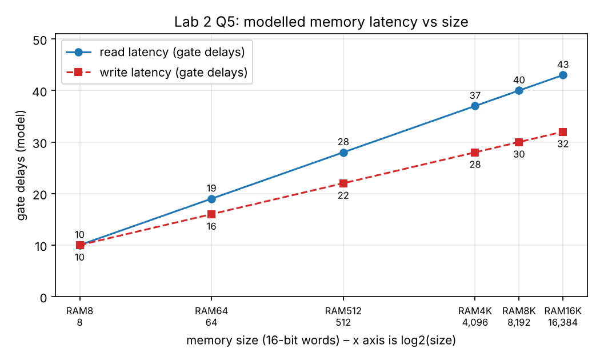

# Lab 2 – Sequential Logic and Memory

**Course:** Nand to Tetris – I (ETCCNT301), K.R. Mangalam University  
**Name:** Harsh Dabas | **Roll no:** 2501730061  
**Tools:** Nand2Tetris Hardware Simulator (Project 3)

All chips were run in the Nand2Tetris simulator with the official test scripts. Where the lab asks for a trace or sample inputs I wrote my own test script. The expected output of each of those was checked against a separate Python model before being saved as the `.cmp` file. The raw simulator output of every run is in [`output/`](output/).

## Test results

| Test script | Result |
|---|---|
| Bit.tst (official) | ✅ PASS |
| Bit-trace.tst (mine) | ✅ PASS |
| Register.tst (official) | ✅ PASS |
| Register-samples.tst (mine) | ✅ PASS |
| RAM8.tst (official) | ✅ PASS |
| RAM8-trace.tst (mine) | ✅ PASS |
| RAM64.tst (official) | ✅ PASS |
| RAM64-trace.tst (mine) | ✅ PASS |
| RAM512.tst (official) | ✅ PASS |
| RAM4K.tst (official) | ✅ PASS |
| RAM8K-trace.tst (mine) | ✅ PASS |
| RAM16K.tst (official) | ✅ PASS |
| PC.tst (official) | ✅ PASS |
| PC-states.tst (mine) | ✅ PASS |

The `.hdl` files here are the final versions of the chips. (Older `.v` files in this folder are not used.) When a chip uses another chip, the simulator picks its own built-in version of that part, so each file is checked for correct wiring on top of the built-in parts.

**How the simulator shows the clock.** A step has two phases: `tick` (clock rises, time `t+`) and `tock` (clock falls, time `t+1`). A clocked chip captures its inputs at the tick, and the new value shows on `out` after the tock. `out` always shows the value stored during the previous clock cycle.

---

## Question 1 – Bit chip and clock trace

A Bit is one flip-flop (DFF) plus a Mux. If `load = 1` the Mux feeds the new `in` to the DFF. If `load = 0` the Mux feeds the DFF its own output back, so the bit is remembered.

```hdl
// 1-bit register: if load, out(t+1) = in(t), else out(t+1) = out(t)
CHIP Bit {
    IN in, load;
    OUT out;
    PARTS:
    Mux(a=dout, b=in, sel=load, out=d);
    DFF(in=d, out=dout, out=out);
}
```

### Trace of `Bit-trace.tst`
```text
| time | in  |load | out |
| 0+   |  1  |  1  |  0  |
| 1    |  1  |  1  |  1  |
| 1+   |  0  |  0  |  1  |
| 2    |  0  |  0  |  1  |
| 2+   |  0  |  1  |  1  |
| 3    |  0  |  1  |  0  |
| 3+   |  1  |  0  |  0  |
| 4    |  1  |  0  |  0  |
| 4+   |  1  |  1  |  0  |
| 5    |  1  |  1  |  1  |
| 5+   |  0  |  0  |  1  |
| 6    |  0  |  0  |  1  |
```

How to read it:
- Time `0+`: `in = 1`, `load = 1`. The clock has risen but `out` is still `0`.
- Time `1`: the clock has fallen, `out` becomes `1`. The stored bit changes only after the tick-tock.
- Time `1+` to `2`: `load = 0` with `in = 0`. The bit ignores `in` and `out` stays `1`.
- Time `2+` to `3`: `load = 1` with `in = 0`, so `out` becomes `0`.
- Time `4+` to `5`: `load = 1` with `in = 1`, so `out` becomes `1`, then `load = 0` keeps it.

The official `Bit.tst` also passes (see the table above).

---

## Question 2 – 16-bit Register

A Register is 16 Bit chips side by side. They share the same `load` signal.

```hdl
// 16-bit register made of 16 Bits
CHIP Register {
    IN in[16], load;
    OUT out[16];
    PARTS:
    Bit(in=in[0], load=load, out=out[0]);
    Bit(in=in[1], load=load, out=out[1]);
    Bit(in=in[2], load=load, out=out[2]);
    Bit(in=in[3], load=load, out=out[3]);
    Bit(in=in[4], load=load, out=out[4]);
    Bit(in=in[5], load=load, out=out[5]);
    Bit(in=in[6], load=load, out=out[6]);
    Bit(in=in[7], load=load, out=out[7]);
    Bit(in=in[8], load=load, out=out[8]);
    Bit(in=in[9], load=load, out=out[9]);
    Bit(in=in[10], load=load, out=out[10]);
    Bit(in=in[11], load=load, out=out[11]);
    Bit(in=in[12], load=load, out=out[12]);
    Bit(in=in[13], load=load, out=out[13]);
    Bit(in=in[14], load=load, out=out[14]);
    Bit(in=in[15], load=load, out=out[15]);
}
```

### Trace with sample inputs (`Register-samples.tst`)
```text
| time |   in   |load |  out   |
| 0+   |  12345 |  1  |      0 |
| 1    |  12345 |  1  |  12345 |
| 1+   |     -1 |  0  |  12345 |
| 2    |     -1 |  0  |  12345 |
| 2+   |  -1234 |  1  |  12345 |
| 3    |  -1234 |  1  |  -1234 |
| 3+   |  32767 |  1  |  -1234 |
| 4    |  32767 |  1  |  32767 |
| 4+   |      5 |  0  |  32767 |
| 5    |      5 |  0  |  32767 |
```

| Sample | in | load | Result |
|---|---|---|---|
| 1 | 12345 | 1 | stored, `out = 12345` after the tock |
| 2 | -1 | 0 | ignored, `out` stays 12345 |
| 3 | -1234 | 1 | stored, `out = -1234` |
| 4 | 32767 | 1 | stored (largest positive 16-bit value) |
| 5 | 5 | 0 | ignored, `out` stays 32767 |

---

## Question 3 – RAM8 (8-register file)

A DMux8Way sends `load` only to the register chosen by `address`. All registers receive the same `in`. A Mux8Way16 reads the chosen register.

```hdl
// RAM8: 8 registers. address picks which register is read / written.
CHIP RAM8 {
    IN in[16], load, address[3];
    OUT out[16];
    PARTS:
    DMux8Way(in=load, sel=address, a=la, b=lb, c=lc, d=ld, e=le, f=lf, g=lg, h=lh);
    Register(in=in, load=la, out=oa);
    Register(in=in, load=lb, out=ob);
    Register(in=in, load=lc, out=oc);
    Register(in=in, load=ld, out=od);
    Register(in=in, load=le, out=oe);
    Register(in=in, load=lf, out=of);
    Register(in=in, load=lg, out=og);
    Register(in=in, load=lh, out=oh);
    Mux8Way16(a=oa, b=ob, c=oc, d=od, e=oe, f=of, g=og, h=oh, sel=address, out=out);
}
```

### Trace: writes to 4+ addresses, all registers shown after every write (`RAM8-trace.tst`)
To print every register I used `RAM8View.hdl`. It is the same circuit as `RAM8.hdl` with the eight register outputs `r0` to `r7` also brought out as pins.

```text
| time | address |  in  |load |  r0  |  r1  |  r2  |  r3  |  r4  |  r5  |  r6  |  r7  | out  |
| 1    |       0 |   11 |  1  |   11 |    0 |    0 |    0 |    0 |    0 |    0 |    0 |   11 |
| 2    |       3 |   33 |  1  |   11 |    0 |    0 |   33 |    0 |    0 |    0 |    0 |   33 |
| 3    |       5 |   55 |  1  |   11 |    0 |    0 |   33 |    0 |   55 |    0 |    0 |   55 |
| 4    |       7 |   77 |  1  |   11 |    0 |    0 |   33 |    0 |   55 |    0 |   77 |   77 |
| 5    |       3 |   99 |  1  |   11 |    0 |    0 |   99 |    0 |   55 |    0 |   77 |   99 |
| 6    |       5 |    0 |  0  |   11 |    0 |    0 |   99 |    0 |   55 |    0 |   77 |   55 |
| 7    |       0 |    0 |  0  |   11 |    0 |    0 |   99 |    0 |   55 |    0 |   77 |   11 |
```

- Write 11 to address 0: only `r0` changes.
- Write 33 to address 3, 55 to address 5, 77 to address 7: each write changes exactly one register and the others keep their value.
- Write 99 to address 3 (second write to the same address): `r3` changes from 33 to 99, all others are unchanged.
- Last two rows use `load = 0`: the registers do not change and `out` just reads the selected register.

---

## Question 4 – RAM8 and RAM64, address decomposition

RAM64 = 8 × RAM8. The 6-bit address is split in two parts:

`address[5..3]` (high 3 bits) selects one of the 8 RAM8 chips, and `address[2..0]` (low 3 bits) selects the register inside that RAM8.

```hdl
// RAM64: 8 x RAM8. Top 3 address bits pick the part, the rest go inside.
CHIP RAM64 {
    IN in[16], load, address[6];
    OUT out[16];
    PARTS:
    DMux8Way(in=load, sel=address[3..5], a=la, b=lb, c=lc, d=ld, e=le, f=lf, g=lg, h=lh);
    RAM8(in=in, load=la, address=address[0..2], out=oa);
    RAM8(in=in, load=lb, address=address[0..2], out=ob);
    RAM8(in=in, load=lc, address=address[0..2], out=oc);
    RAM8(in=in, load=ld, address=address[0..2], out=od);
    RAM8(in=in, load=le, address=address[0..2], out=oe);
    RAM8(in=in, load=lf, address=address[0..2], out=of);
    RAM8(in=in, load=lg, address=address[0..2], out=og);
    RAM8(in=in, load=lh, address=address[0..2], out=oh);
    Mux8Way16(a=oa, b=ob, c=oc, d=od, e=oe, f=of, g=og, h=oh, sel=address[3..5], out=out);
}
```

| address | 6-bit binary | high 3 bits → which RAM8 | low 3 bits → register inside it |
|---|---|---|---|
| 0 | `000000` | `000` = 0 | `000` = 0 |
| 9 | `001001` | `001` = 1 | `001` = 1 |
| 38 | `100110` | `100` = 4 | `110` = 6 |
| 63 | `111111` | `111` = 7 | `111` = 7 |

Example: address 38 = `100110`. The high bits `100` select RAM8 number 4, and the low bits `110` select register 6 inside it. So address 38 is register 6 of RAM8 number 4.

### Trace (`RAM64-trace.tst`)
The `address` column is printed in binary (the simulator pads it with one extra leading `0`, so ignore the first digit).

```text
| time | address |  in  |load | out  |
| 1    | 0000000 |   11 |  1  |   11 |
| 2    | 0001001 |   22 |  1  |   22 |
| 3    | 0100110 |   33 |  1  |   33 |
| 4    | 0111111 |   44 |  1  |   44 |
| 5    | 0000000 |    0 |  0  |   11 |
| 6    | 0001001 |    0 |  0  |   22 |
| 7    | 0100110 |    0 |  0  |   33 |
| 8    | 0111111 |    0 |  0  |   44 |
| 9    | 0000001 |    0 |  0  |    0 |
```

Each address that was written (0, 9, 38, 63) is read back with the same value, and the never-written address 1 reads 0. This shows that every address reaches a different register.

---

## Question 5 – RAM512, RAM8K, RAM16K and latency

Every bigger memory is 8 (or 2 or 4) copies of the previous one. The top bits of the address choose the copy and the remaining bits go to all copies.

| chip | words | address bits | top bits select | remaining bits |
|---|---|---|---|---|
| RAM512 | 512 | 9 | address[6..8] → RAM64 (8 of them) | address[0..5] → inside the sub-chip |
| RAM4K | 4,096 | 12 | address[9..11] → RAM512 (8 of them) | address[0..8] → inside the sub-chip |
| RAM8K | 8,192 | 13 | address[12] → RAM4K (2 of them) | address[0..11] → inside the sub-chip |
| RAM16K | 16,384 | 14 | address[12..13] → RAM4K (4 of them) | address[0..11] → inside the sub-chip |

`RAM4K` is included because RAM8K and RAM16K are built from it.

```hdl
// RAM512: 8 x RAM64. Top 3 address bits pick the part, the rest go inside.
CHIP RAM512 {
    IN in[16], load, address[9];
    OUT out[16];
    PARTS:
    DMux8Way(in=load, sel=address[6..8], a=la, b=lb, c=lc, d=ld, e=le, f=lf, g=lg, h=lh);
    RAM64(in=in, load=la, address=address[0..5], out=oa);
    RAM64(in=in, load=lb, address=address[0..5], out=ob);
    RAM64(in=in, load=lc, address=address[0..5], out=oc);
    RAM64(in=in, load=ld, address=address[0..5], out=od);
    RAM64(in=in, load=le, address=address[0..5], out=oe);
    RAM64(in=in, load=lf, address=address[0..5], out=of);
    RAM64(in=in, load=lg, address=address[0..5], out=og);
    RAM64(in=in, load=lh, address=address[0..5], out=oh);
    Mux8Way16(a=oa, b=ob, c=oc, d=od, e=oe, f=of, g=og, h=oh, sel=address[6..8], out=out);
}
```

```hdl
// RAM4K: 8 x RAM512. Top 3 address bits pick the part, the rest go inside.
CHIP RAM4K {
    IN in[16], load, address[12];
    OUT out[16];
    PARTS:
    DMux8Way(in=load, sel=address[9..11], a=la, b=lb, c=lc, d=ld, e=le, f=lf, g=lg, h=lh);
    RAM512(in=in, load=la, address=address[0..8], out=oa);
    RAM512(in=in, load=lb, address=address[0..8], out=ob);
    RAM512(in=in, load=lc, address=address[0..8], out=oc);
    RAM512(in=in, load=ld, address=address[0..8], out=od);
    RAM512(in=in, load=le, address=address[0..8], out=oe);
    RAM512(in=in, load=lf, address=address[0..8], out=of);
    RAM512(in=in, load=lg, address=address[0..8], out=og);
    RAM512(in=in, load=lh, address=address[0..8], out=oh);
    Mux8Way16(a=oa, b=ob, c=oc, d=od, e=oe, f=of, g=og, h=oh, sel=address[9..11], out=out);
}
```

```hdl
// 8K memory: 8192 16-bit registers = two RAM4K chips.
// address[12] (the top bit) picks the RAM4K, address[0..11] picks the register inside it.
CHIP RAM8K {
    IN in[16], load, address[13];
    OUT out[16];

    PARTS:
    DMux(in=load, sel=address[12], a=la, b=lb);
    RAM4K(in=in, load=la, address=address[0..11], out=oa);
    RAM4K(in=in, load=lb, address=address[0..11], out=ob);
    Mux16(a=oa, b=ob, sel=address[12], out=out);
}
```

```hdl
// RAM16K: 4 x RAM4K. Top 2 address bits pick the RAM4K.
CHIP RAM16K {
    IN in[16], load, address[14];
    OUT out[16];
    PARTS:
    DMux4Way(in=load, sel=address[12..13], a=la, b=lb, c=lc, d=ld);
    RAM4K(in=in, load=la, address=address[0..11], out=oa);
    RAM4K(in=in, load=lb, address=address[0..11], out=ob);
    RAM4K(in=in, load=lc, address=address[0..11], out=oc);
    RAM4K(in=in, load=ld, address=address[0..11], out=od);
    Mux4Way16(a=oa, b=ob, c=oc, d=od, sel=address[12..13], out=out);
}
```

### Results
- `RAM512`, `RAM4K`, `RAM16K`: official test scripts pass.
- `RAM8K` is not in the official course, so I wrote `RAM8K-trace.tst`. It writes to the first and last register of each RAM4K half (addresses 0, 4095, 4096 and 8191), reads them back and also reads an unwritten address:

```text
| time |    address     |  in   |load |  out  |
| 1    | 00000000000000 |   211 |  1  |   211 |
| 2    | 00111111111111 |   322 |  1  |   322 |
| 3    | 01000000000000 |   433 |  1  |   433 |
| 4    | 01111111111111 |   544 |  1  |   544 |
| 5    | 00000000000000 |     0 |  0  |   211 |
| 6    | 00111111111111 |     0 |  0  |   322 |
| 7    | 01000000000000 |     0 |  0  |   433 |
| 8    | 01111111111111 |     0 |  0  |   544 |
| 9    | 01000000000000 |     0 |  0  |   433 |
```

(The 14-digit address column has one padding digit at the front. The real address is 13 bits.)

### Read/write latency for each size
**Simulated latency in the simulator:** in the simulator every size reads and writes in **1 clock cycle** (one tick-tock). This is what all the traces above show, and it is the same for 8 words and for 16K words. The simulator does not model gate delays, so the interesting difference between sizes comes from the hardware itself.

**Hardware latency (a model, not a measurement).** I counted how many gates a signal passes through in the circuits above, with these assumed delays: one gate = 1 delay unit, Mux2 = 3 (NOT, AND, OR), so Mux8Way16 = 9 (three Mux levels) and DMux8Way = 6; a register read = 1; a Bit write = 3 for its load Mux + 1 for the flip-flop set-up. The read data passes through one Mux8Way16 per level. The write `load` signal passes through one DMux8Way per level.

- Read latency = `1 + 9 × levels (+ extra Mux for the 2-way or 4-way level)`
- Write latency = `3 + 6 × levels (+ extra DMux) + 1`

| chip | words | 8-way levels | read (gate delays) | write (gate delays) | simulator latency |
|---|---|---|---|---|---|
| RAM8 | 8 | 1 | 10 | 10 | 1 cycle |
| RAM64 | 64 | 2 | 19 | 16 | 1 cycle |
| RAM512 | 512 | 3 | 28 | 22 | 1 cycle |
| RAM4K | 4,096 | 4 | 37 | 28 | 1 cycle |
| RAM8K | 8,192 | 4 + 2-way | 40 | 30 | 1 cycle |
| RAM16K | 16,384 | 4 + 4-way | 43 | 32 | 1 cycle |



The latency grows **logarithmically**: each time the memory gets 8× bigger, one more level is added (+9 for reads, +6 for writes). Going from 8 words to 16K words (2048× bigger) only increases the read delay from 10 to 43 gate delays. In real chips the wires get longer too, so large memories are slower than this simple model suggests. That is why computers use a small fast memory (registers, cache) in front of a big slow one.

---

## Question 6 – Program Counter (PC)

PC holds the address of the next instruction. Priority is **reset > load > inc**:

- `reset = 1` → out = 0
- else `load = 1` → out = in
- else `inc = 1` → out = out + 1
- else out stays the same

It is built from a 16-bit Register (the state), an Inc16 (adds 1) and three Mux16 chips that apply the priority order. The register always loads (`load = true`).

```hdl
// Program counter. Priority: reset > load > inc.
// if reset: out=0   else if load: out=in   else if inc: out=out+1   else: out=out
CHIP PC {
    IN in[16], load, inc, reset;
    OUT out[16];
    PARTS:
    Inc16(in=cur, out=plus1);
    Mux16(a=cur, b=plus1, sel=inc, out=o1);
    Mux16(a=o1, b=in, sel=load, out=o2);
    Mux16(a=o2, b=false, sel=reset, out=o3);
    Register(in=o3, load=true, out=cur, out=out);
}
```

### State transition table (`PC-states.tst`)
Before each combination the counter was set to **100** and `in` was set to **55**. The values below are the counter value after one clock cycle for all 8 combinations of `reset`, `load` and `inc`.

| reset | load | inc | in | state before | state after | rule applied |
|---|---|---|---|---|---|---|
| 0 | 0 | 0 | 55 | 100 | 100 | hold: out unchanged |
| 0 | 0 | 1 | 55 | 100 | 101 | inc: out = out + 1 |
| 0 | 1 | 0 | 55 | 100 | 55 | load: out = in |
| 0 | 1 | 1 | 55 | 100 | 55 | load: out = in |
| 1 | 0 | 0 | 55 | 100 | 0 | reset: out = 0 |
| 1 | 0 | 1 | 55 | 100 | 0 | reset: out = 0 |
| 1 | 1 | 0 | 55 | 100 | 0 | reset: out = 0 |
| 1 | 1 | 1 | 55 | 100 | 0 | reset: out = 0 |

Simulator output:
```text
| time |reset|load | inc |  in  | out  |
| 2    |  0  |  0  |  0  |   55 |  100 |
| 4    |  0  |  0  |  1  |   55 |  101 |
| 6    |  0  |  1  |  0  |   55 |   55 |
| 8    |  0  |  1  |  1  |   55 |   55 |
| 10   |  1  |  0  |  0  |   55 |    0 |
| 12   |  1  |  0  |  1  |   55 |    0 |
| 14   |  1  |  1  |  0  |   55 |    0 |
| 16   |  1  |  1  |  1  |   55 |    0 |
```

For a normal program, `inc = 1` runs the next instruction, `load = 1` is a jump (`in` is the jump target) and `reset = 1` restarts the program from address 0. Note that when `reset` and `load` are both 1, reset wins, and when `load` and `inc` are both 1, load wins.
