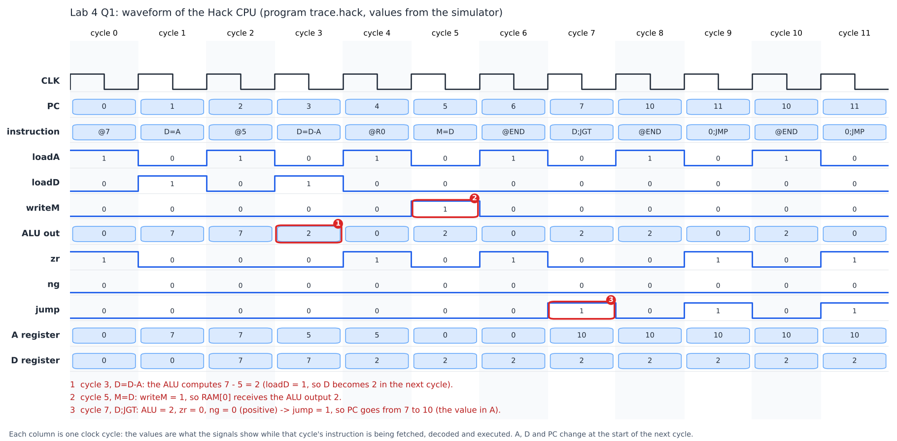
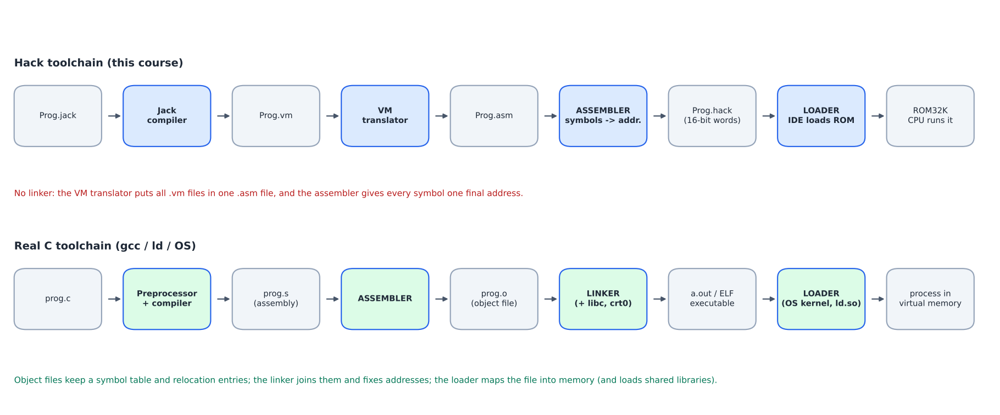

# Lab 4 – Waveforms, Instruction Cycle and Toolchains

**Course:** Nand to Tetris – I (ETCCNT301), K.R. Mangalam University  
**Name:** Harsh Dabas | **Roll no:** 2501730061  
**Tools:** Nand2Tetris Hardware Simulator and CPU Emulator, my assembler `capstone/assembler.py`

## What is in this folder

| File | What it is |
|---|---|
| `TraceCPU.hdl`, `TraceComputer.hdl` | the Lab 3 CPU and Computer with extra output pins, so the internal signals (ALU output, `zr`, `ng`, A, D, `jump`, ...) can be printed |
| `TraceComputer.tst` + `trace.hack` | Questions 1 and 2: runs `programs/trace.asm` and prints the signals |
| `CPUBugPos.hdl`, `CPUBugZr.hdl`, `ComputerBug*.hdl`, `TraceCPUBug.hdl`, `TraceComputerBug.hdl` | Question 3: copies of the CPU with a deliberately wrong flag logic |
| `Flags-*.tst`, `FlagTrace*.tst` | Question 3 tests |
| `programs/io.asm`, `MemoryView.hdl`, `MemoryView.tst` | Question 4 |
| `diagrams/` | `waveform_cpu.png`, `toolchain_comparison.png` |
| `output/` | all simulator and emulator output |

`CPU.hdl`, `Computer.hdl` and `Memory.hdl` are the ones from Lab 3. Every table and the waveform below come from real simulator output. The first run (`TraceComputer`) was also checked cycle by cycle against a separate Python model of the Hack CPU (PC, A and D match in each of the first 10 cycles, until the program reaches its final loop).

**How to read the simulator rows.** The simulator clock has two phases, `tick` (clock rises, time `t+`) and `tock` (clock falls, time `t+1`). In the traces I print one row per cycle after the `tock` and an `eval`. At that moment the registers hold their new values, the ROM shows the next instruction, and the ALU and flags show the result for that instruction. This is "the state during cycle `n`".

---

## Question 1 – Waveform of the ALU and control signals (12 clock cycles)

Program (`programs/trace.asm`): computes 7 − 5 = 2, stores it in RAM[0], then does a conditional jump on the ALU flags.

```asm
// Lab 4 Q1/Q2 program: R0 = 7 - 5, then a conditional jump that depends on the ALU flags.
@7
D=A
@5
D=D-A      // D = 2
@R0
M=D        // RAM[0] = 2
@END
D;JGT      // D = 2 > 0, so the jump to END is taken (uses the zr / ng flags)
@R1        // skipped
M=1        // skipped
(END)
@END
0;JMP
```



The same data as a table (annotated per instruction):

| cycle | PC | instruction | loadA | loadD | writeM | ALU out | zr | ng | jump | A | D | what happens |
|---|---|---|---|---|---|---|---|---|---|---|---|---|
| 0 | 0 | `@7` | 1 | 0 | 0 | 0 | 1 | 0 | 0 | 0 | 0 | A-instruction: A gets 7 (visible in cycle 1) |
| 1 | 1 | `D=A` | 0 | 1 | 0 | 7 | 0 | 0 | 0 | 7 | 0 | ALU passes A: D gets 7 |
| 2 | 2 | `@5` | 1 | 0 | 0 | 7 | 0 | 0 | 0 | 7 | 7 | A-instruction: A gets 5 |
| 3 | 3 | `D=D-A` | 0 | 1 | 0 | 2 | 0 | 0 | 0 | 5 | 7 | ALU computes D - A = 7 - 5 = 2: D gets 2 |
| 4 | 4 | `@R0` | 1 | 0 | 0 | 0 | 1 | 0 | 0 | 5 | 2 | A-instruction: A gets 0 (address of R0) |
| 5 | 5 | `M=D` | 0 | 0 | 1 | 2 | 0 | 0 | 0 | 0 | 2 | writeM = 1: RAM[0] gets the ALU output D = 2 |
| 6 | 6 | `@END` | 1 | 0 | 0 | 0 | 1 | 0 | 0 | 0 | 2 | A-instruction: A gets 10 (address of END) |
| 7 | 7 | `D;JGT` | 0 | 0 | 0 | 2 | 0 | 0 | 1 | 10 | 2 | ALU = D = 2: not zero, not negative, so positive: jump = 1, PC gets A = 10 |
| 8 | 10 | `@END` | 1 | 0 | 0 | 2 | 0 | 0 | 0 | 10 | 2 | (at the jump target) A gets 10 |
| 9 | 11 | `0;JMP` | 0 | 0 | 0 | 0 | 1 | 0 | 1 | 10 | 2 | 0;JMP: ALU = 0, zr = 1, jump = 1: PC gets 10 (infinite loop) |
| 10 | 10 | `@END` | 1 | 0 | 0 | 2 | 0 | 0 | 0 | 10 | 2 | A gets 10 again |
| 11 | 11 | `0;JMP` | 0 | 0 | 0 | 0 | 1 | 0 | 1 | 10 | 2 | 0;JMP again: the program idles here |

Notes:
- For an A-instruction (such as `@7`) the CPU still runs the ALU, because the bits that normally select the ALU function are just part of the number. The ALU output in those cycles is **ignored**, since `loadD = 0` and `writeM = 0`. For example in cycle 4 (`@R0`, all instruction bits 0) the ALU does `D & A` = 2 & 5 = 0.
- The ALU control signals `zx nx zy ny f no` are the bits 11 to 6 of the instruction, `a` is bit 12. They are not drawn separately because they are just the instruction bits; the ALU out, `zr` and `ng` rows show their effect.
- `loadA = 1` for every A-instruction and for C-instructions with destination A; `loadD = 1` when the destination contains D (`D=A`, `D=D-A`); `writeM = 1` only for `M=D`.
- The simulator output behind the waveform is [`output/TraceComputer.out`](output/TraceComputer.out) (it has a row for every tick and tock).

---

## Question 2 – Fetch–decode–execute timing

The Hack CPU is a single-cycle CPU. The ROM, the decoding logic and the ALU contain no clock, so the three steps happen one after another through gates inside the **same clock cycle**:

1. **Fetch:** the PC value goes to ROM32K, which outputs the instruction.
2. **Decode:** the instruction bits become the control signals (`loadA`, `loadD`, `writeM`, the ALU function bits, the jump bits).
3. **Execute:** the ALU computes its result and flags, and the jump logic decides `jump`.
4. At the clock edge the results are **stored**: A, D, the RAM cell, and the new PC (PC + 1, or A if `jump`).

The critical path of one cycle is `PC → ROM32K → decode → ALU → zr/ng → jump logic → PC input`. The clock period must be longer than this whole path.

### Evidence from the simulator (instructions at cycles 3, 4 and 5)
Raw rows of `TraceComputer.out` (`+` rows are after the tick, the others after the tock and `eval`):

| time | pc | instr | alu | zr | ng | jump | A | D | memOut | RAM[0] |
|---|---|---|---|---|---|---|---|---|---|---|
| 3 | 3 | 1110010011010000 | 2 | 0 | 0 | 0 | 5 | 7 | 0 | 0 |
| 3+ | 3 | 1110010011010000 | 2 | 0 | 0 | 0 | 5 | 7 | 0 | 0 |
| 4 | 4 | 0000000000000000 | 0 | 1 | 0 | 0 | 5 | 2 | 0 | 0 |
| 4+ | 4 | 0000000000000000 | 0 | 1 | 0 | 0 | 5 | 2 | 0 | 0 |
| 5 | 5 | 1110001100001000 | 2 | 0 | 0 | 0 | 0 | 2 | 0 | 0 |
| 5+ | 5 | 1110001100001000 | 2 | 0 | 0 | 0 | 0 | 2 | 0 | 2 |
| 6 | 6 | 0000000000001010 | 0 | 1 | 0 | 0 | 0 | 2 | 2 | 2 |

| instruction | cycle (PC) | fetch complete | decode complete | execute complete | results stored |
|---|---|---|---|---|---|
| `D=D-A` | 3 | time `3`: pc = 3, instr = `1110010011010000` | time `3`: a = 0 (uses A), loadD = 1 | time `3`: ALU out = 2, zr = 0, ng = 0 | time `4`: D = 2 |
| `@R0` | 4 | time `4`: pc = 4, instr = `0000000000000000` | time `4`: bit 15 = 0, so loadA = 1 | time `4`: A-instruction, no ALU result used | time `5`: A = 0 |
| `M=D` | 5 | time `5`: pc = 5, instr = `1110001100001000` | time `5`: writeM = 1, loadA = loadD = 0 | time `5`: ALU out = 2 (the value of D) | time `5+`: RAM[0] = 2 (clock edge); time `6`: memOut = 2 |

Reading the rows:
- At time `3` the PC is 3, the instruction is already `D=D-A` (`1110010011010000`) and the ALU already shows 2 (7 − 5). Fetch, decode and execute are therefore all complete **before** the clock edge of cycle 3. D is still 7.
- At time `4` the D register has changed to 2. This is the clock edge that stores the result, so the instruction from cycle 3 is finished at time 4. The PC is 4 and the ROM shows the next instruction.
- For `M=D` (cycle 5), `writeM = 1` and RAM[0] is still 0 at time `5`. It becomes 2 at time `5+`, which is the clock edge of this cycle. It can be read back (`memOut = 2`) from cycle 6 on, when A = 0.

So an instruction **never** needs more than one cycle: fetch, decode and execute are all complete within cycle `n`, and the results are visible at the beginning of cycle `n + 1`.

---

## Question 3 – When the `zr` and `ng` flags matter

**Where the flags come from.** The ALU gives two flags with every result: `zr = 1` when `out = 0`, and `ng = 1` when `out < 0` (bit 15 is 1). The CPU uses them only for jumps:

`jump = isC AND ( (j1 AND ng) OR (j2 AND zr) OR (j3 AND positive) )`, with `positive = NOT zr AND NOT ng`.

`j1 j2 j3` are the jump bits of the instruction (`JLT`, `JEQ`, `JGT`). When `jump = 1` the PC loads the address in A, otherwise it counts up.

**Where they are critical: conditional jumps.** `D;JGT` in the Max program (`D = R0 - R1`) has to know if the subtraction result is positive. Only the flags tell the CPU that. In the trace of Question 1, `D;JGT` with D = 2 has `zr = 0`, `ng = 0`, so `positive = 1` and the jump is taken (cycle 7). A negative result sets `ng = 1`, zero sets `zr = 1`.

The jump logic is also used by the unconditional jump `0;JMP`. The ALU output of `0` is zero, so `zr = 1`, and `JMP` has all three jump bits set. A CPU that gets `zr` wrong would break **every** loop that ends with `0;JMP`.

### What happens if the flag logic is wrong
I made two copies of the CPU (`CPUBugPos.hdl`, `CPUBugZr.hdl`) with one deliberate mistake each, and ran four programs on all three CPUs (`Flags-*.tst`):

- **Bug A:** `positive` is computed as `NOT zr` only (the check of `ng` is forgotten), so negative numbers count as positive.
- **Bug B:** the `JEQ` bit is not combined with `zr` (the `zr` flag is not used).

| program and inputs | correct CPU: result | bug A (`positive` ignores ng) | bug B (`zr` not used for JEQ) |
|---|---|---|---|
| Max, R0 = 3, R1 = 5 (R0 - R1 = -2, negative) | 5 (PC 14) | 3 (PC 14) ❌ wrong result | 3 (PC 20) ❌ wrong result |
| Max, R0 = 23456, R1 = 12345 (R0 - R1 > 0) | 23456 (PC 14) | 23456 (PC 14) ✅ same | 23456 (PC 24) ❌ PC ran away |
| zero, R0 = 0 (R1 starts as 9) | 0 (PC 10) | 0 (PC 10) ✅ same | 0 (PC 20) ❌ PC ran away |
| zero, R0 = -4 (R1 starts as 9) | 1 (PC 10) | 1 (PC 10) ✅ same | 0 (PC 20) ❌ wrong result |

What this shows:
- **Bug A** returns the wrong maximum when the subtraction is negative: for `max(3, 5)` it gives 3 instead of 5. With positive differences it looks fine, so the bug is easy to miss.
- **Bug B** breaks `JEQ`, **and also every `0;JMP`**. The PC ran away to 20 and 24, which is past the end of the program (Max has 16 instructions, zero has 12; the CPU keeps executing empty ROM words). In `zero` with R0 = -4 it gives 0 instead of 1, because the code falls into the "R1 = 0" block. In some runs the stored number happens to be right, but the PC shows that the program no longer behaves.

### Cycle-by-cycle view of Bug A (`max(3, 5)`)
Rows of [`FlagTrace.out`](output/FlagTrace.out) (correct CPU) and [`FlagTraceBug.out`](output/FlagTraceBug.out) (Bug A). In cycle 5 the instruction is `D;JGT` with D = 3 − 5 = −2, so `ng = 1`:

| CPU | cycle | PC | instruction | ALU out | zr | ng | jump | A | D | RAM[2] |
|---|---|---|---|---|---|---|---|---|---|---|
| correct | 4 | 4 | `0000000000001010` | 0 | 1 | 0 | 0 | 1 | -2 | 0 |
| **bug A** | 4 | 4 | `0000000000001010` | 0 | 1 | 0 | 0 | 1 | -2 | 0 |
| correct | 5 | 5 | `1110001100000001` | -2 | 0 | 1 | 0 | 10 | -2 | 0 |
| **bug A** | 5 | 5 | `1110001100000001` | -2 | 0 | 1 | 1 | 10 | -2 | 0 |
| correct | 6 | 6 | `0000000000000001` | 10 | 0 | 0 | 0 | 10 | -2 | 0 |
| **bug A** | 6 | 10 | `0000000000000000` | 10 | 0 | 0 | 0 | 10 | -2 | 0 |
| correct | 7 | 7 | `1111110000010000` | 5 | 0 | 0 | 0 | 1 | -2 | 0 |
| **bug A** | 7 | 11 | `1111110000010000` | 3 | 0 | 0 | 0 | 0 | -2 | 0 |
| correct | 8 | 8 | `0000000000001100` | 1 | 0 | 0 | 0 | 1 | 5 | 0 |
| **bug A** | 8 | 12 | `0000000000000010` | 0 | 1 | 0 | 0 | 0 | 3 | 0 |
| correct | 14 | 14 | `0000000000001110` | 4 | 0 | 0 | 0 | 14 | 5 | 5 |
| **bug A** | 14 | 14 | `0000000000001110` | 2 | 0 | 0 | 0 | 14 | 3 | 3 |

- Cycle 5, the instruction is `D;JGT` and the ALU gives −2 with `ng = 1`. The correct CPU keeps `jump = 0`, so the PC goes to 6 and the program copies R1 (= 5) to R2.
- The buggy CPU sees "not zero" and takes the jump (`jump = 1`). The PC goes to 10, which copies R0 (= 3) to R2. The final RAM[2] is 3, not 5.

---

## Question 4 – Machine-level trace of a program with keyboard and screen I/O

**Memory-mapped I/O:** the CPU has no special I/O instructions. The screen and keyboard are ordinary memory addresses, and the Memory chip routes the addresses to the right device:

| Address range | Device | Top two bits of the 15-bit address (`[14] [13]`) |
|---|---|---|
| 0 – 16383 | RAM | `00` or `01` |
| 16384 – 24575 | Screen (8192 words) | `10` |
| 24576 | Keyboard | `11` |

`SCREEN = 16384 =` `100000000000000`, `KBD = 24576 =` `110000000000000`.

### The program (`programs/io.asm`)
```asm
// Lab 4 Q4: keyboard and screen (memory-mapped I/O).
// Forever: if a key is pressed (KBD != 0) paint the first 16 pixels black (SCREEN[0] = -1),
//          otherwise clear them (SCREEN[0] = 0).
(LOOP)
@KBD
D=M        // read the keyboard register (RAM[24576])
@PRESSED
D;JNE      // key pressed?
@SCREEN
M=0        // no key: SCREEN[0] = 0 (white)
@LOOP
0;JMP
(PRESSED)
@SCREEN
M=-1       // key: SCREEN[0] = -1 (all 16 bits = 1, black)
@LOOP
0;JMP
```

| PC | assembly | machine code | fields |
|---|---|---|---|
| 0 | `@KBD` | `0110000000000000` | `0` `110000000000000` |
| 1 | `D=M` | `1111110000010000` | `111` `1` `110000` `010` `000` |
| 2 | `@PRESSED` | `0000000000001000` | `0` `000000000001000` |
| 3 | `D;JNE` | `1110001100000101` | `111` `0` `001100` `000` `101` |
| 4 | `@SCREEN` | `0100000000000000` | `0` `100000000000000` |
| 5 | `M=0` | `1110101010001000` | `111` `0` `101010` `001` `000` |
| 6 | `@LOOP` | `0000000000000000` | `0` `000000000000000` |
| 7 | `0;JMP` | `1110101010000111` | `111` `0` `101010` `000` `111` |
| 8 | `@SCREEN` | `0100000000000000` | `0` `100000000000000` |
| 9 | `M=-1` | `1110111010001000` | `111` `0` `111010` `001` `000` |
| 10 | `@LOOP` | `0000000000000000` | `0` `000000000000000` |
| 11 | `0;JMP` | `1110101010000111` | `111` `0` `101010` `000` `111` |

- `@KBD` is `0110000000000000`. The leading `0` marks an A-instruction and the other 15 bits are the address 24576.
- `D=M` is `1111110000010000`: `a = 1` so the ALU takes M = RAM[A] = RAM[24576], which is the **keyboard register** (the ASCII code of the pressed key, or 0 if no key is down). `D` is the destination.
- `@SCREEN` is `0100000000000000` (address 16384).
- `M=-1` is `1110111010001000`: the ALU output is −1 (`111010`), the destination bit for M is set, so `writeM = 1` and the value is written into RAM[A] = RAM[16384]. That is the first word of the screen.

### Trace, no key pressed (`RAM[24576] = 0`), 12 instructions
| step | PC | instruction | machine code | A / D / M before | A / D / M after | next PC | RAM write |
|---|---|---|---|---|---|---|---|
| 1 | 0 | `@KBD` | `0110000000000000` | 0 / 0 / 0 | 24576 / 0 / 0 | 1 |  |
| 2 | 1 | `D=M` | `1111110000010000` | 24576 / 0 / 0 | 24576 / 0 / 0 | 2 |  |
| 3 | 2 | `@PRESSED` | `0000000000001000` | 24576 / 0 / 0 | 8 / 0 / 0 | 3 |  |
| 4 | 3 | `D;JNE` | `1110001100000101` | 8 / 0 / 0 | 8 / 0 / 0 | 4 |  |
| 5 | 4 | `@SCREEN` | `0100000000000000` | 8 / 0 / 0 | 16384 / 0 / 0 | 5 |  |
| 6 | 5 | `M=0` | `1110101010001000` | 16384 / 0 / 0 | 16384 / 0 / 0 | 6 | RAM[16384] = 0 |
| 7 | 6 | `@LOOP` | `0000000000000000` | 16384 / 0 / 0 | 0 / 0 / 0 | 7 |  |
| 8 | 7 | `0;JMP` | `1110101010000111` | 0 / 0 / 0 | 0 / 0 / 0 | 0 |  |
| 9 | 0 | `@KBD` | `0110000000000000` | 0 / 0 / 0 | 24576 / 0 / 0 | 1 |  |
| 10 | 1 | `D=M` | `1111110000010000` | 24576 / 0 / 0 | 24576 / 0 / 0 | 2 |  |
| 11 | 2 | `@PRESSED` | `0000000000001000` | 24576 / 0 / 0 | 8 / 0 / 0 | 3 |  |
| 12 | 3 | `D;JNE` | `1110001100000101` | 8 / 0 / 0 | 8 / 0 / 0 | 4 |  |

`D = 0`, so `D;JNE` is **not** taken. The program continues with `@SCREEN` and `M=0`, writing 0 to `SCREEN[0]` (16 white pixels), and `0;JMP` goes back to the top (PC = 0).

### Trace, key `K` pressed (`RAM[24576] = 75`, the ASCII code of `K`), 12 instructions
| step | PC | instruction | machine code | A / D / M before | A / D / M after | next PC | RAM write |
|---|---|---|---|---|---|---|---|
| 1 | 0 | `@KBD` | `0110000000000000` | 0 / 0 / 0 | 24576 / 0 / 75 | 1 |  |
| 2 | 1 | `D=M` | `1111110000010000` | 24576 / 0 / 75 | 24576 / 75 / 75 | 2 |  |
| 3 | 2 | `@PRESSED` | `0000000000001000` | 24576 / 75 / 75 | 8 / 75 / 0 | 3 |  |
| 4 | 3 | `D;JNE` | `1110001100000101` | 8 / 75 / 0 | 8 / 75 / 0 | 8 |  |
| 5 | 8 | `@SCREEN` | `0100000000000000` | 8 / 75 / 0 | 16384 / 75 / 0 | 9 |  |
| 6 | 9 | `M=-1` | `1110111010001000` | 16384 / 75 / 0 | 16384 / 75 / -1 | 10 | RAM[16384] = -1 |
| 7 | 10 | `@LOOP` | `0000000000000000` | 16384 / 75 / -1 | 0 / 75 / 0 | 11 |  |
| 8 | 11 | `0;JMP` | `1110101010000111` | 0 / 75 / 0 | 0 / 75 / 0 | 0 |  |
| 9 | 0 | `@KBD` | `0110000000000000` | 0 / 75 / 0 | 24576 / 75 / 75 | 1 |  |
| 10 | 1 | `D=M` | `1111110000010000` | 24576 / 75 / 75 | 24576 / 75 / 75 | 2 |  |
| 11 | 2 | `@PRESSED` | `0000000000001000` | 24576 / 75 / 75 | 8 / 75 / 0 | 3 |  |
| 12 | 3 | `D;JNE` | `1110001100000101` | 8 / 75 / 0 | 8 / 75 / 0 | 8 |  |

`D = 75`, so `D;JNE` is **taken** (PC goes from 3 to 8). The program writes `M=-1`, which is `1111111111111111`: all 16 bits are 1, so the 16 pixels at the top-left of the screen turn black. The next loop round would read the keyboard again.

These two traces were produced by running `io.hack` on the CPU emulator code of the Nand2Tetris web IDE with the keyboard register preset to 0 and to 75 (see [`output/io_key0.json`](output/io_key0.json) and [`output/io_key75.json`](output/io_key75.json)). The simulator's HDL test cannot press a key without a person, so the key value is set directly in the emulator's RAM, which is what a real key press does.

### How the Memory chip decodes the binary addresses (`MemoryView.tst`)
`MemoryView.hdl` is the Lab 3 Memory chip with the decoding signals as extra pins. The test writes a RAM word, writes to the first and last screen word, reads the keyboard address and tries to write to it:

```hdl
// Lab 4 Q4: the Memory chip of Lab 3 with the address-decoding signals brought out as pins.
CHIP MemoryView {
    IN in[16], load, address[15];
    OUT out[16], ramSel, screenSel, kbdSel, loadRamOut, loadScreenOut;

    PARTS:
    DMux4Way(in=load, sel=address[13..14], a=loadRam1, b=loadRam2, c=loadScreen, d=loadKbd);
    Or(a=loadRam1, b=loadRam2, out=loadRam, out=loadRamOut);
    RAM16K(in=in, load=loadRam, address=address[0..13], out=ramOut);
    Screen(in=in, load=loadScreen, address=address[0..12], out=screenOut);
    Keyboard(out=kbdOut);
    Mux4Way16(a=ramOut, b=ramOut, c=screenOut, d=kbdOut, sel=address[13..14], out=out);
    // which device is selected by address[14] address[13]
    Not(in=address[14], out=n14);
    Not(in=address[13], out=n13);
    Or(a=n14, b=false, out=ramSel);                     // 0x: RAM
    And(a=address[14], b=n13, out=screenSel);           // 10: Screen
    And(a=address[14], b=address[13], out=kbdSel);      // 11: Keyboard
    Or(a=loadScreen, b=false, out=loadScreenOut);
}
```

```text
| time |     address     |load |   in   |  out   |ramSe|scree|kbdSe|loadR|loadS|
| 1    | 000000001100100 |  1  |      5 |      5 |  1  |  0  |  0  |  1  |  0  |
| 2    | 100000000000000 |  1  |     -1 |     -1 |  0  |  1  |  0  |  0  |  1  |
| 3    | 100000000000000 |  1  |      0 |      0 |  0  |  1  |  0  |  0  |  1  |
| 4    | 101111111111111 |  1  |     -1 |     -1 |  0  |  1  |  0  |  0  |  1  |
| 5    | 110000000000000 |  0  |      0 |      0 |  0  |  0  |  1  |  0  |  0  |
| 6    | 110000000000000 |  1  |      7 |      0 |  0  |  0  |  1  |  0  |  0  |
```

- Address `100000000000000` (16384, `SCREEN`): `[14] = 1`, `[13] = 0`, so `screenSel = 1` and the write goes to the screen chip (`loadScreen = 1`, the RAM is not loaded).
- Address `101111111111111` (24575): still `10`, the last screen word.
- Address `110000000000000` (24576, `KBD`): `11`, so `kbdSel = 1` and `out` comes from the keyboard. Both `loadRam` and `loadScreen` stay 0, so the write of 7 is ignored and `out` is still 0 (no key pressed).
- Address `000000001100100` (100): top bits `00` so the RAM is used.

The program sees none of this. It only does `A = 24576; D = M` and `A = 16384; M = -1`, and the address bits steer the data to the keyboard and the screen.

---

## Question 5 – Hack toolchain compared with a real C toolchain



| Stage | Hack (this course) | Real C toolchain (gcc on Linux) |
|---|---|---|
| High-level language | Jack | C |
| Compiler output | VM code (`.vm`), then translated to Hack assembly (`.asm`) | assembly for the real CPU (`.s`) |
| **Assembler** | `Prog.asm` → `Prog.hack`. Turns mnemonics into 16-bit words, replaces labels and variables with final addresses (variables start at RAM[16]). One pass over symbols, then one pass to emit. | `prog.s` → `prog.o` (object file). Machine code plus a **symbol table** and **relocation entries**, because the final addresses are not known yet. |
| **Linker** | None. The VM translator joins all `.vm` files into one `.asm` file, and the assembler fixes every address at once. | `ld` joins several `.o` files and libraries (`libc.a`, `crt0.o`), resolves symbols between files (`printf`, `main`), applies the relocations, and writes the executable (ELF). |
| **Loader** | The Nand2Tetris tool just copies the `.hack` words into ROM32K. The program is at address 0 and always uses the same physical addresses. | The OS kernel (`execve`) reads the ELF headers, maps the code and data segments into a new virtual address space, sets up the stack, and starts at `_start`. The dynamic loader (`ld.so`) loads shared libraries (`libc.so`) and resolves their symbols at run time. |
| File format | plain text of 0 and 1, one 16-bit instruction per line | binary ELF with headers, sections, symbol tables, debug info |
| Addresses | absolute and physical (ROM and RAM are separate memories) | virtual addresses, relocated at link time or load time |
| Memory protection | none | page permissions (read/write/execute), user and kernel mode |
| Entry point | PC = 0 | `_start` (C runtime), which calls `main` |

**Summary of the differences.** Both toolchains turn text into numbers the CPU can run. The Hack toolchain is a straight line with a single file and one assembler step, so a linker is not needed. A real toolchain keeps every `.c` file separate, so it needs object files, a linker to combine them, and a loader to place the result in memory safely.

### Security implications
- **Hack has no protection.** Instructions live in ROM, which a running program cannot change, so a program cannot inject new code. But RAM has no limits: every address can be read or written, there is no user and kernel mode, and no bounds checking. In compiled Jack code the VM keeps return addresses and pointers in RAM, so a program that writes outside an array can overwrite them and change where the program jumps to.
- **Real toolchains add defences that the Hack setup does not have:** non-executable memory (W^X / NX), address space layout randomisation (ASLR, which the loader applies), stack canaries added by the compiler, and read-only relocation tables (RELRO) after linking.
- **The linker and loader are also attack points.** Dynamic linking can be hijacked if an attacker controls the library search path or `LD_PRELOAD`; a vulnerable library that is linked statically stays in every program that includes it; and a modified compiler, assembler or library in the toolchain can put malicious code into every program it produces (supply-chain attacks).
